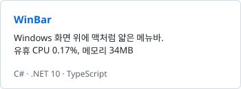
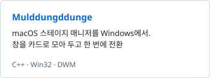
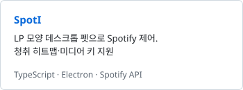

<picture><source media="(prefers-color-scheme: dark)" srcset="assets/header-dark.svg"></picture>

대덕소프트웨어마이스터고등학교에서 임베디드와 AI를 함께 다루는 개발자입니다.

Student at Daedeok Software Meister High School. I work across the whole stack — from registers, BSPs and drivers, up through Linux, into AI models.
I train CNNs that catch defects in PIN diodes, write firmware that pulls readings off devices, and build apps on top of foundation models.

<picture>
  <source media="(prefers-color-scheme: dark)" srcset="https://skillicons.dev/icons?i=c%2Ccpp%2Cpy%2Cpytorch%2Ctensorflow%2Copencv%2Clinux%2Craspberrypi%2Ccmake%2Cts%2Celectron%2Cfastapi%2Csqlite%2Cgit&perline=14&theme=dark">
  
</picture>

### Projects

<a href="https://github.com/ilfpns/PhoSem"><picture><source media="(prefers-color-scheme: dark)" srcset="assets/project-phosem-dark.svg"></picture></a>
<a href="https://github.com/ilfpns/pith"><picture><source media="(prefers-color-scheme: dark)" srcset="assets/project-pith-dark.svg"></picture></a>
 
<a href="https://github.com/ilfpns/WinBar"><picture><source media="(prefers-color-scheme: dark)" srcset="assets/project-winbar-dark.svg"></picture></a>
<a href="https://github.com/ilfpns/Mulddungddunge"><picture><source media="(prefers-color-scheme: dark)" srcset="assets/project-mulddungddunge-dark.svg"></picture></a>
 
<a href="https://github.com/ilfpns/SpotI"><picture><source media="(prefers-color-scheme: dark)" srcset="assets/project-spoti-dark.svg"></picture></a>
<a href="https://github.com/ilfpns/Quant"><picture><source media="(prefers-color-scheme: dark)" srcset="assets/project-quant-dark.svg"></picture></a>

### Awards

- **WRO 2026** — 금상 · Gold medal
- **PIUDA** — 수상 · Award
- **김포 SW·AI 경진대회** — 수상 · Gimpo SW/AI Competition award

### Now

- 🔬 PhoSem — 고객사 의뢰로 PIN 다이오드 불량 검출 CNN 개발
- 🤖 NAVER Connect Robotics Cup 2026 — IsaacLab에서 휴머노이드 RL 정책 튜닝
- 🛠️ 22명 규모 임베디드 동아리 Nonamed 회장 · M_lab 커널 스터디 공동 설립

[Portfolio](https://ilfpns.github.io) · [TIL](https://github.com/ilfpns/IL) · yeomsh09@gmail.com

### GitHub Stats

<picture><source media="(prefers-color-scheme: dark)" srcset="assets/stats-dark.svg"></picture>
<picture><source media="(prefers-color-scheme: dark)" srcset="assets/langs-dark.svg"></picture>

