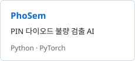
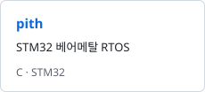
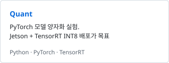
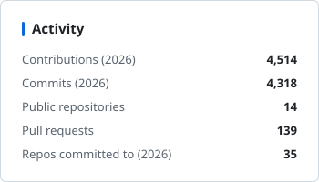
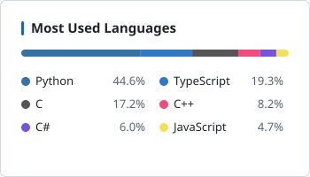

<picture><source media="(prefers-color-scheme: dark)" srcset="assets/header-dark.svg"></picture>

대덕소프트웨어마이스터고등학교에서 임베디드와 AI를 함께 다루는 개발자입니다.

Student at Daedeok Software Meister High School. I work across the whole stack — from registers, BSPs and drivers, up through Linux, into AI models.
I train CNNs that catch defects in PIN diodes, write firmware that pulls readings off devices, and build apps on top of foundation models.

<picture>
  <source media="(prefers-color-scheme: dark)" srcset="https://skillicons.dev/icons?i=c%2Ccpp%2Cpy%2Cpytorch%2Ctensorflow%2Copencv%2Clinux%2Craspberrypi%2Ccmake%2Cgit&perline=14&theme=dark">
  
</picture>

### Projects

<a href="https://github.com/ilfpns/PhoSem"><picture><source media="(prefers-color-scheme: dark)" srcset="assets/project-phosem-dark.svg"></picture></a>
<a href="https://github.com/ilfpns/pith"><picture><source media="(prefers-color-scheme: dark)" srcset="assets/project-pith-dark.svg"></picture></a>
<a href="https://github.com/ilfpns/Quant"><picture><source media="(prefers-color-scheme: dark)" srcset="assets/project-quant-dark.svg"></picture></a>

### Awards

- **WRO Korea 2026** — 금상 (2위) · 국제대회 진출권
   Gold (2nd place), qualified for the international final
- **빛가람 AI·ICT 경진대회** — 수상
   Bitgaram AI·ICT Competition award
- **PhoSem** — 우수 개발물 표창장
   Commendation for outstanding development (PIN diode defect detection)
- **2026 글로벌 피우다 프로젝트** — 장려상 · WiFi CSI 기반 낙상 감지 Edge AI
   Honorable mention, WiFi-CSI fall detection on ESP32
- **김포 SW/AI 경진대회** — 장려상 (4위)
   Honorable mention (4th place)

[Blog](https://ysh223.tistory.com/) · [TIL](https://github.com/ilfpns/IL) · yeomsh09@gmail.com

### GitHub Stats

<picture><source media="(prefers-color-scheme: dark)" srcset="assets/stats-dark.svg"></picture>
<picture><source media="(prefers-color-scheme: dark)" srcset="assets/langs-dark.svg"></picture>

